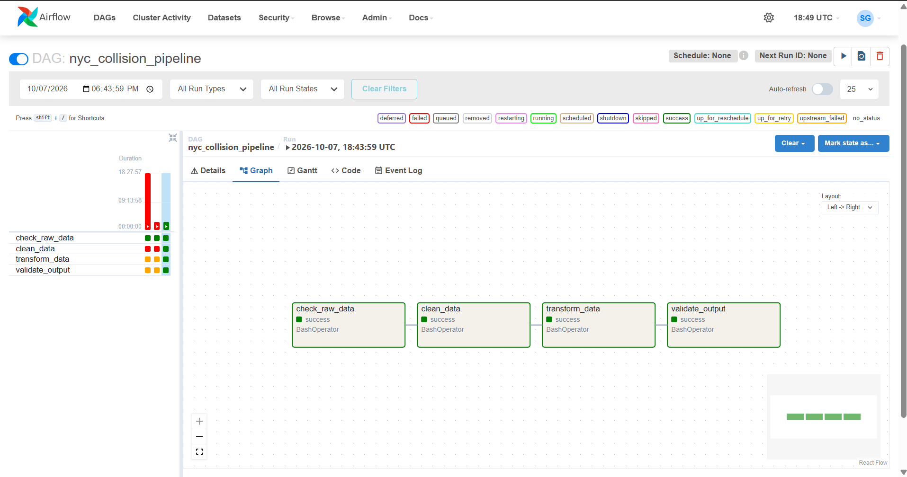
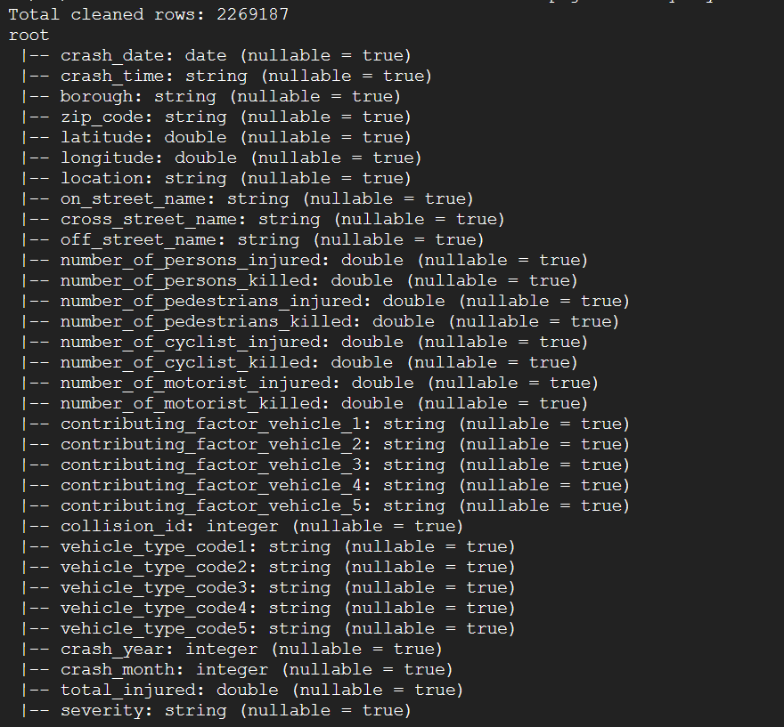
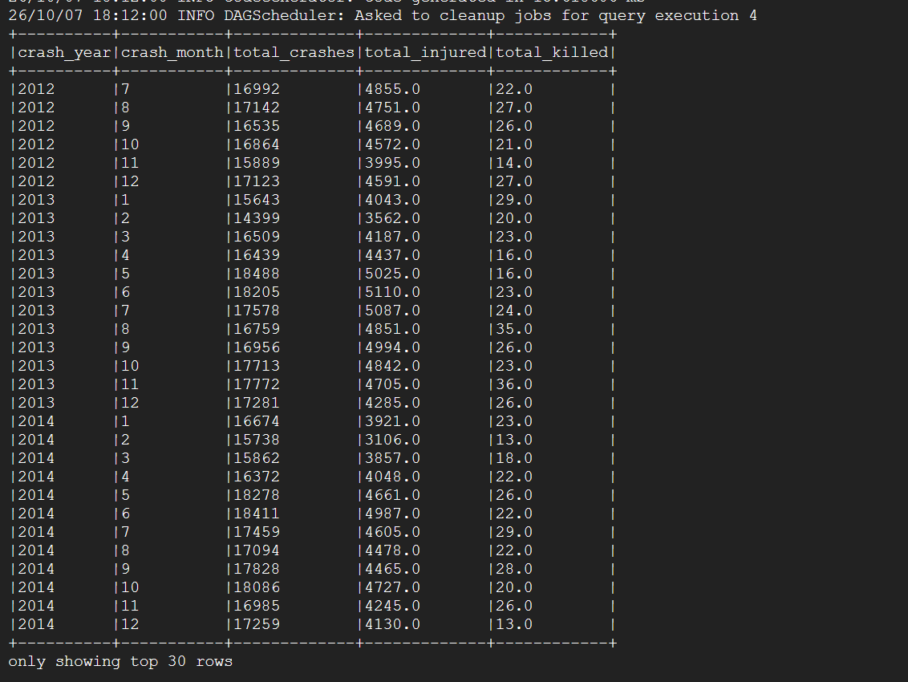
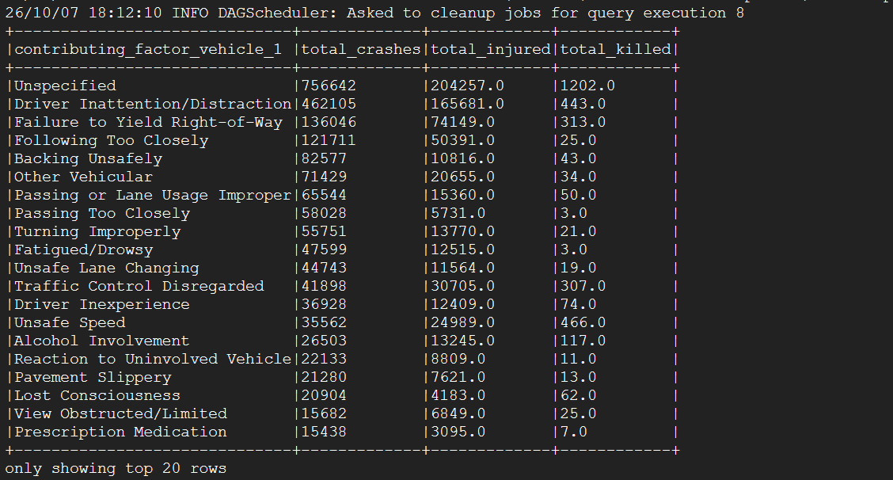
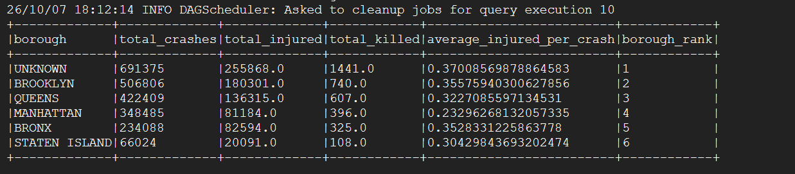

# NYC Motor Vehicle Collisions: Spark + Airflow pipeline

An end-to-end batch pipeline that turns **2.27 million NYC crash records** into analysis-ready Parquet tables. PySpark handles cleaning and aggregation, and Apache Airflow orchestrates and validates each run. It ran on a Google Cloud VM.

```
NYC Open Data ─► raw CSV ─► PySpark cleaning ─► cleaned Parquet ─► PySpark transformations ─► 5 analytical tables ─► Airflow validation
```



## What the pipeline found

All 2,269,187 records with a valid crash date survived cleaning.

**By borough.** Brooklyn has the most recorded crashes, but the largest group is actually crashes with **no borough recorded (691k, about 30%)**, so the pipeline keeps them as `UNKNOWN` instead of dropping them.

| Rank | Borough | Crashes | Injured | Killed | Injured per crash |
|---|---|---|---|---|---|
| 1 | UNKNOWN | 691,375 | 255,868 | 1,441 | 0.37 |
| 2 | Brooklyn | 506,806 | 180,301 | 740 | 0.36 |
| 3 | Queens | 422,409 | 136,315 | 607 | 0.32 |
| 4 | Manhattan | 348,485 | 81,184 | 396 | 0.23 |
| 5 | Bronx | 234,088 | 82,594 | 325 | 0.35 |
| 6 | Staten Island | 66,024 | 20,091 | 108 | 0.30 |

Manhattan has the third-most crashes but the lowest injury rate per crash.

**By severity.** 75% of crashes injure no one, but 3,469 fatal crashes account for 3,617 deaths.

| Severity | Rule | Crashes | Injured | Killed |
|---|---|---|---|---|
| MINOR | no injuries or deaths | 1,707,973 | 0 | 0 |
| MODERATE | 1–2 injuries | 514,683 | 595,952 | 0 |
| SEVERE | 3+ injuries | 43,062 | 158,652 | 0 |
| FATAL | at least one death | 3,469 | 1,749 | 3,617 |

**By contributing factor.** After "Unspecified" (757k), **driver inattention/distraction** is the leading recorded cause (462k crashes, 443 deaths). The deadliest factors per crash are different: **unsafe speed** (466 deaths in 36k crashes) and **traffic control disregarded** (307 deaths in 42k crashes) are far more lethal than common causes like following too closely (25 deaths in 122k crashes).

## How it works

### 1. Cleaning (`spark/clean_collisions.py`)
- **Column standardization:** `CONTRIBUTING FACTOR VEHICLE 1` becomes `contributing_factor_vehicle_1`.
- **Robust date parsing:** `try_to_date(crash_date, "MM/dd/yyyy")` turns malformed dates into nulls instead of failing the job, and those rows are then removed.
- **Numeric fields:** injury and fatality counts are cast to numbers, with missing values set to 0.
- **Missing boroughs:** labelled `UNKNOWN` so the records stay in the totals.
- **Derived features:** `crash_year`, `crash_month`, `total_injured` and a four-level `severity`.
- Output is written as **Parquet** for fast columnar reads downstream.

### 2. Transformations (`spark/transform_collisions.py`)
Five Parquet outputs:

| Output | Contents |
|---|---|
| `borough_summary` | crashes, injuries, deaths and average injuries per crash, by borough |
| `monthly_summary` | crashes, injuries and deaths by year and month |
| `severity_summary` | the same totals for each severity level |
| `factor_summary` | totals by first recorded contributing factor, ranked by crash count |
| `borough_ranking` | boroughs ranked with a window function: `row_number().over(Window.orderBy(desc("total_crashes")))` |

### 3. Orchestration (`airflow/dags/nyc_collision_pipeline.py`)
Four sequential tasks: `check_raw_data` (fails fast if the CSV is missing), `clean_data` (`spark-submit`), `transform_data` (`spark-submit`), and `validate_output` (confirms all five Parquet directories exist).

## Repository layout

```text
.
├── spark/
│   ├── clean_collisions.py        # raw CSV -> cleaned Parquet
│   └── transform_collisions.py    # cleaned Parquet -> 5 analytical tables
├── airflow/dags/
│   └── nyc_collision_pipeline.py  # 4-task DAG
├── scripts/download_data.sh       # fetches the dataset from NYC Open Data
├── docs/images/                   # Spark output and Airflow screenshots from the run
└── requirements.txt
```

## Run it

Requires Java 11 or 17 and Python 3.10+.

```bash
pip install -r requirements.txt
export PROJECT_DIR=$(pwd)

./scripts/download_data.sh                    # ~500 MB CSV -> data/raw/collisions.csv
spark-submit spark/clean_collisions.py
spark-submit spark/transform_collisions.py    # -> output/*
```

With Airflow, copy or symlink `airflow/dags/nyc_collision_pipeline.py` into your DAGs folder, set `PROJECT_DIR` in the Airflow environment, and trigger `nyc_collision_pipeline`.

## Run screenshots

| Cleaned schema | Monthly trends |
|---|---|
|  |  |

| Contributing factors | Borough ranking |
|---|---|
|  |  |

## Data

[Motor Vehicle Collisions – Crashes](https://data.cityofnewyork.us/Public-Safety/Motor-Vehicle-Collisions-Crashes/h9gi-nx95), NYC Open Data (NYPD). Records start in July 2012. The dataset isn't included in the repo because of its size.

## Possible extensions

Dashboards on top of the Parquet outputs, geographic hotspot analysis from the latitude/longitude fields, trend detection, and a model predicting crash severity.

## Tools

PySpark, Apache Airflow, Parquet, Google Cloud (Compute Engine VM)
